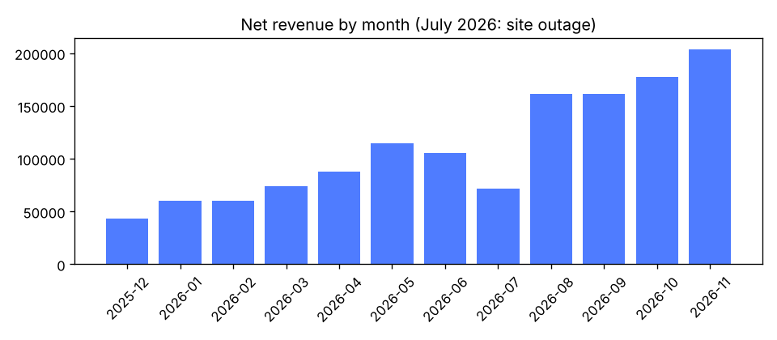
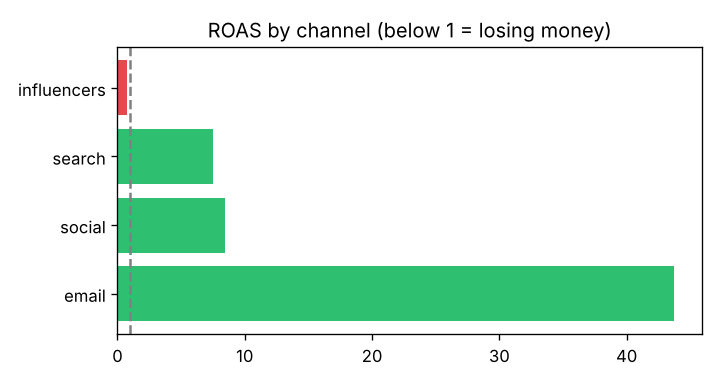

# Sales Analytics in SQL — online store, 12 months

**Role:** Junior Data / SQL Analyst · **Stack:** SQL (window functions, CTE), SQLite, Python, matplotlib, pytest, GitHub Actions

A year of data from an electronics web store (synthetic, generated with a fixed seed) and six SQL analyses a business owner actually asks for: *How is revenue trending? Do customers come back? Which products matter? Which ad channel burns money? What gets returned?*

## Run in 2 commands
```bash
pip install -r requirements.txt
python analyze.py --charts      # builds db/shop.db, prints every table, saves charts to images/
pytest -q                       # 8 tests check each query against facts planted in the data
```

## Findings
| # | Question | SQL techniques | Finding |
|---|---|---|---|
| 1 | [Monthly revenue & growth](queries/01_monthly_revenue.sql) | CTE, `LAG()` | Revenue grew from 43k to 204k; **July dropped −31.8 %** (site outage week), August recovered **+124 %** |
| 2 | [Cohort retention](queries/02_cohort_retention.sql) | cohort index math, conditional aggregation | ~20–25 % of each cohort buys again in month 1; the April cohort's month 3 falls to 10.6 % — the same July outage |
| 3 | [ABC analysis](queries/03_abc_analysis.sql) | running total `SUM() OVER (ORDER BY …)` | Laptops dominate class A: a few SKUs make most of the revenue → keep them in stock first |
| 4 | [RFM segments](queries/04_rfm_segments.sql) | `NTILE(5)`, `julianday()` | 608 **"At risk"** customers bring 423k — the biggest win-back opportunity |
| 5 | [Channel ROAS & CAC](queries/05_channel_roas.sql) | joins across 3 tables, aggregation | **Influencers: ROAS 0.74, CAC 698** — the only channel that loses money; email returns 43× |
| 6 | [Returns by category](queries/06_returns_by_category.sql) | `SUM(returned)`, rates | **Headphones: 19.7 % returns**, 3× any other category, 36.8k revenue lost |




## Recommendations I would bring to the business
1. **Cut or renegotiate influencer spend** (169k/year at ROAS 0.74) and move budget to email and social.
2. **Investigate headphone returns**: sizes/compatibility in product cards, a supplier quality check.
3. **Win-back campaign for "At risk"** customers — they already spent the most.
4. **Add uptime monitoring**: one bad week in July cost about a third of the month's revenue.

## How it is checked
The generator plants known facts (a July outage, a loss-making channel, a high-return category). Tests assert that each query finds exactly them, that monthly revenue equals the raw sum of non-returned items, that RFM covers every buyer once and that cohort months in the future are `NULL`, not `0`.

## Structure
```
db/schema.sql      tables: products, customers, orders, order_items, ad_spend
db/gen_data.py     deterministic data generator (random.seed(42))
queries/*.sql      six analyses
analyze.py         runs everything, prints tables, draws charts
tests/             pytest checks for every query
```
